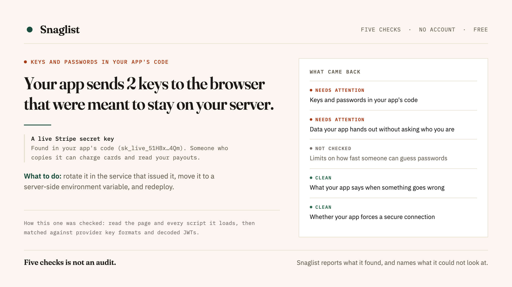

# Snaglist



A free security scan for people who built an app with AI coding tools and have never had anyone check
it for holes. Paste a live URL, get a plain-language report on five things that commonly go wrong.

The audience is a founder who shipped something real with Claude Code, Cursor, Replit, Lovable, or
Bolt, who can deploy but cannot read a bundle and spot an API key. The report is written for that
person, so it says what someone could do with a finding rather than which header was missing.

## The five checks

| Check | What it does | Confidence |
| --- | --- | --- |
| Keys in the frontend | Reads the page and its scripts, matches against provider-specific key formats, decodes JWTs to catch a Supabase `service_role` key | High on a finding, medium on a clean result |
| Open API routes | Pulls `/api/...` paths out of the bundle, asks each one for data with no login, reports only the ones that return personal information | High on a finding, medium on a clean result |
| Rate limiting | Finds a sign-in shaped endpoint, sends ten deliberately wrong logins, watches for a 429 or rate limit headers | High on a pass, medium on a finding |
| Verbose errors | Asks for pages that do not exist and sends one malformed request, then reads every error for stack traces, database errors, and server file paths | High on a finding, medium on a clean result |
| HTTPS enforcement | Loads the secure address, then asks for the insecure one without following the redirect | High either way |

Each check returns `pass`, `attention`, or `not_checked`. `not_checked` is the answer when the check
could not gather what it needed. It never becomes a pass.

## What it deliberately does not do

- It is not an audit. It is five checks on what an app shows the outside world.
- It never signs in, so it cannot see anything behind a login.
- It does not test Supabase row-level security, authorisation logic, injection, or dependency CVEs.
- It does not read repositories. The input is a URL.
- It sends no payload designed to execute anything. The only thing it sends that is not a plain
  request is a deliberately wrong email and password, to see whether the login has a rate limit.
- There are no accounts, no saved history, and no payment.

## Running it

```bash
npm install
npm run dev        # http://localhost:3000
```

```bash
npm test           # 200+ unit tests, no network needed
npm run lint       # tsc --noEmit
npm run build
```

Copy `.env.example` to `.env.local` if you want to set the contact URL that appears in the scanner's
user agent, or point the manual review link somewhere real. Neither is required to run it.

## Scanning safely

Scanning a URL somebody pasted means sending traffic to a third party server, so the limits are built
into the code rather than written on a wall:

- The target's resolved addresses are checked against a denylist (loopback, private ranges,
  link-local including cloud metadata, CGNAT, multicast, reserved) inside the socket's own DNS lookup,
  so the address that gets connected to is the address that got checked. IP literals, which skip DNS
  entirely, hit a second gate before the socket opens.
- Redirects are followed by hand, four hops maximum, each one revalidated.
- One scan is capped at 40 requests, 25 seconds, and 6 MB.
- `POST /api/scan` allows 5 scans per IP per 15 minutes, 3 at a time.
- Every request says `SnaglistScanner/0.1`. It does not pretend to be a browser.
- The form requires a tick confirming you own the app or have permission to test it, and the API
  refuses without it.

Full reasoning is in `docs/foundation.md`, including a section on what these guardrails do not cover.

## How it is put together

Next.js App Router, TypeScript in strict mode, Tailwind v4, `undici` for outbound requests, Vitest for
tests. One page, one API route.

```
src/lib/scanner/
  addresses.ts    the address and hostname denylist
  net.ts          guarded request, connect-time lookup, budget
  url.ts          what counts as a scannable address
  collect.ts      page and bundle gathering, shared by the checks
  context.ts      per-scan state
  index.ts        orchestration
  checks/         one file per check
```

Each check splits into pure analysis functions and one `run` that does the I/O. The pure half is what
the tests exercise, because a false pass would come from there.

## Honest limitations

- **The rate limit check can be wrong.** A ten request burst cannot tell "no limiter" apart from
  "limiter set at twenty". The report says so where the user will read it, but some findings will not
  be real problems.
- **The auth check only sees routes it can find.** Routes the public bundle never references are
  invisible to it.
- **Secret detection sees the entry chunk.** Code splitting means a key used only on an admin page
  will not turn up.
- **Rate limiting is in memory.** It resets on restart and does not hold across more than one
  instance. Fine for one box, wrong for two.
- **`npm audit` reports three advisories.** All of them are in packages Next.js pulls in itself
  (`postcss` and `sharp`), and every published Next version through 16.3 is affected, so there is no
  version to move to. Nothing in this repo depends on either package directly.

## Licence

Proprietary, all rights reserved. See `LICENCE`.

Deliberately not open source: this sends deliberate request bursts at whatever
address it is given, and the licence carries the disclaimers that go with that.
Opening it later is easy; closing it again is not.
