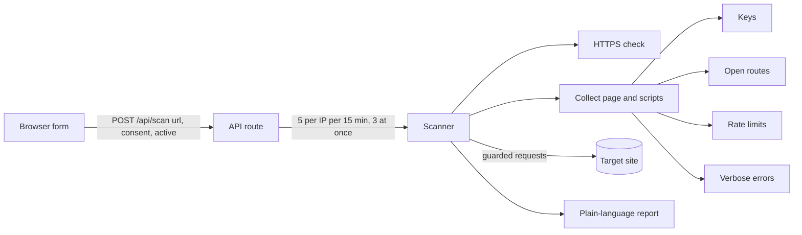

# Quietword

A free security scan for apps built with AI coding tools: paste a URL, get a plain-language report on five common holes.


Quietword is for founders who shipped a real app with an AI coding tool and have never had anyone check it. They can deploy, but they cannot read a JavaScript bundle and spot an API key. The report is written for that person. It says what someone could do with each finding and what to do next, not which header was missing.

> **Only scan sites you own or have permission to test.** The form requires a tick confirming that, and the API refuses a scan without it. Active checks, which send wrong logins, are a second opt-in, off by default, and are only for apps you own or have written permission to test.

## Features

- **Leaked keys.** Matches the page and its scripts against provider-specific key formats, and decodes JWTs to catch a Supabase `service_role` key shipped to the browser.
- **Open API routes.** Pulls `/api/...` paths out of the bundle, requests each one without logging in, and reports only those that return personal information.
- **Missing rate limits.** An opt-in active check. Finds a login endpoint and sends ten wrong logins, watching for a `429` or rate limit headers.
- **Verbose errors.** Triggers 404s, plus one malformed request when active checks are on, then reads the responses for stack traces, database errors and server file paths.
- **Missing HTTPS.** Loads the secure address, then requests the insecure one without following redirects.
- **Honest verdicts.** Each check returns `pass`, `attention` or `not_checked`. A check that could not gather what it needed says so and never reports a pass.
- **Safe by default.** Without active checks, every request is a `GET` or `HEAD`. Private, loopback and cloud metadata addresses are refused at connect time, and every scan has hard request, time and size limits.

## Quick start

Tested with Node.js 26.

```bash
git clone https://github.com/gshepptech/quietword.git
cd quietword
npm install
npm run dev        # http://localhost:3000
```

Open the page, paste the URL of an app you own, tick the permission box and run the scan. Tick "Also run active checks" as well to include the login rate limit test.

## How it works



The scanner fetches the target's home page and the scripts it loads once, and every check reads from that shared collection. Each check is split into pure analysis functions and a single `run` that does the I/O. The tests exercise the pure half, because a false pass would come from there.

### What the scanner sends

A scan runs in one of two modes. **Passive** is the default and sends only `GET` requests. **Active** adds a small number of `POST`s and runs only when the request to `/api/scan` carries `"active": true`, which the form sends only when "Also run active checks" is ticked.

| Check | Passive (default) | Active adds |
| --- | --- | --- |
| Collect | `GET /`, then `GET` each script the page loads | nothing |
| HTTPS | `GET` the `https://` address, then `GET` the `http://` address without following the redirect | nothing |
| Open routes | `GET` each `/api/...` path found in the bundle, plus one made-up path as a control | nothing |
| Verbose errors | `GET` two random paths that should 404 | one `POST` with truncated JSON (`{"quietword":`) to an API path |
| Rate limits | nothing; reported as not checked | up to 4 `POST`s to find a login endpoint, then up to 10 in total to that endpoint, each with `{"email":"quietword-scan@example.com","password":"this-is-not-a-real-password"}` |

The passive guarantee does not rest on each check behaving. `ScanContext.visit` in [`src/lib/scanner/context.ts`](src/lib/scanner/context.ts) is the only way a check sends a request, and in passive mode it refuses any method other than `GET` or `HEAD` before a socket opens.

Active mode sends wrong logins only to paths that look like a login (`login`, `log-in`, `signin`, `sign-in`). A path is skipped if it also looks like it could create something: sign-up, register, password reset, OTP, magic link, email, verify, invite, waitlist, subscribe, contact or newsletter. A wrong password changes nothing on a login route. The rule is `isProbeTarget` in [`src/lib/scanner/checks/rate-limit.ts`](src/lib/scanner/checks/rate-limit.ts).

In either mode, no request carries a payload designed to execute anything: no injection strings, no scripts, no file uploads. Quietword never signs in, and it never sends `PUT`, `PATCH` or `DELETE`.

### Limits on every scan

These limits are enforced in code. No path through the code can exceed them.

- Resolved addresses are checked against a denylist (loopback, private ranges, link-local including cloud metadata, CGNAT, multicast, reserved) inside the socket's own DNS lookup. The address that gets connected to is the address that was checked. IP literals, which skip DNS, are checked before the socket opens.
- Redirects are followed by hand, at most four hops, each one checked again.
- One scan makes at most 40 requests, runs at most 25 seconds and reads at most 6 MB.
- `POST /api/scan` allows 5 scans per IP per 15 minutes, 3 at a time.
- Every request identifies itself as `QuietwordScanner/0.1`. It does not pretend to be a browser.

### Project layout

```
src/app/              the page and the /api/scan route
src/components/       the form and the report
src/lib/ratelimit.ts  limits on Quietword's own endpoint
src/lib/scanner/
  addresses.ts        address and hostname denylist
  net.ts              guarded requests, connect-time lookup, budget
  url.ts              what counts as a scannable address
  collect.ts          page and script gathering, shared by the checks
  context.ts          per-scan state
  index.ts            orchestration
  checks/             one file per check
```

Next.js App Router, TypeScript in strict mode, Tailwind v4, `undici` for outbound requests, Vitest for tests.

## Configuration

All settings are optional. Copy `.env.example` to `.env.local` to set them.

| Variable | Purpose |
| --- | --- |
| `SCANNER_CONTACT_URL` | Appended to the user agent, so a site owner reading their logs can find out who scanned them |
| `NEXT_PUBLIC_REVIEW_CONTACT` | Where the "book a manual review" link points (`mailto:` or a booking URL) |
| `NEXT_PUBLIC_REVIEW_PRICE` | Price shown for the manual review, printed as given (for example `$180`) |

## Limitations

- **It is not an audit.** It runs five checks on what an app shows the outside world. It does not test Supabase row-level security, authorization logic, injection or dependency CVEs, and it does not read source repositories.
- **It cannot see behind a login.** It never signs in.
- **The rate limit check needs active mode.** A passive scan reports it as not checked. It also tests only login routes, so a sign-up or password reset route with no limit goes unreported.
- **The rate limit check can be wrong.** A ten-request burst cannot tell "no limiter" apart from "limiter set at twenty". The report says so.
- **The open routes check sees only routes the public bundle references.**
- **Key detection sees the scripts the home page loads.** A key used only on a lazily loaded admin page will not turn up.
- **Quietword's own rate limit is in memory.** It resets on restart and does not hold across more than one instance.
- **`npm audit` still reports advisories.** They are in `postcss` (pinned by Next.js 15) and in Vitest and its `tinypool` dependency (development only). Clearing them means moving to Next.js 16 and Vitest 5, which are major upgrades.

## Development

```bash
npm test           # 287 unit tests, no network needed
npm run lint       # tsc --noEmit
npm run build      # production build
```

## Licence

Proprietary, all rights reserved. See [LICENCE](LICENCE).
